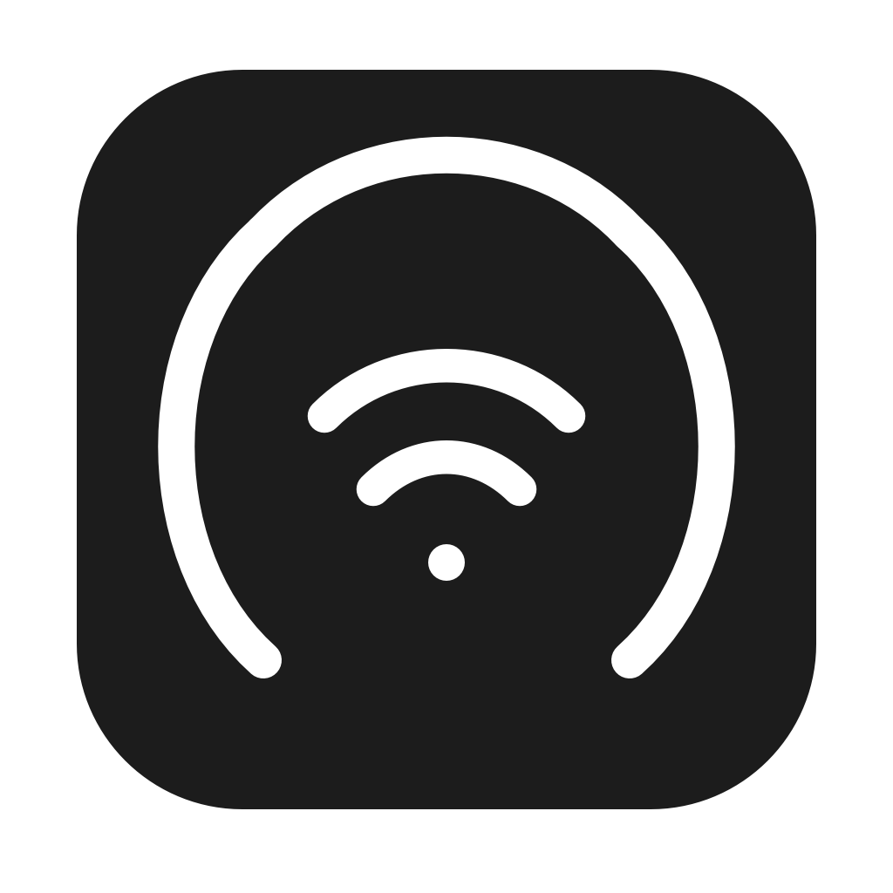
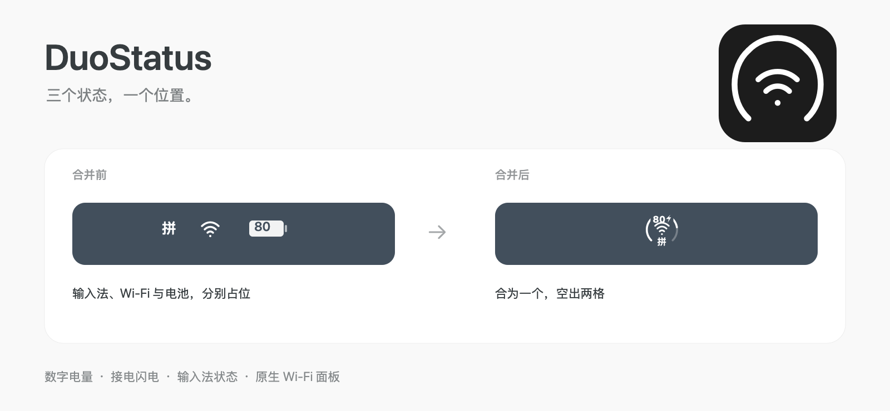
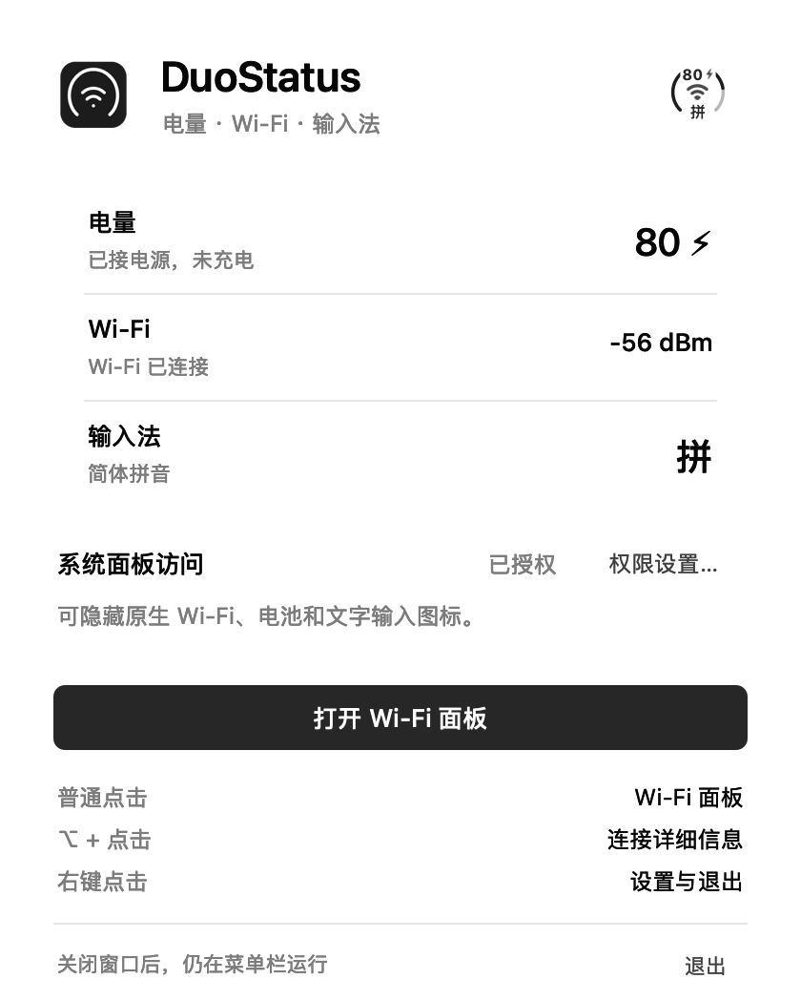

<div align="center">



# DuoStatus

**电量、Wi-Fi 和输入法，合在一个菜单栏图标里。**

[](#运行要求)
[](#运行要求)
[](LICENSE)
[](README.md)

**[下载](https://github.com/zhuxc1221/DuoStatus/releases/latest)** · [功能](#功能) · [安装与设置](#安装与设置) · [从源码构建](#从源码构建) · [隐私](#隐私)

<br>



</div>

---

DuoStatus 将数字电量、电量圆环、Wi-Fi 和当前输入法状态合成一个菜单栏图标。关闭系统原有的 Wi-Fi、电池和输入法图标，就能空出两个位置。点击组合图标，通过控制中心打开真正的 macOS Wi-Fi 面板。

## 功能

- **合为一个图标**：外圈显示电量，中间显示 Wi-Fi，顶部电量数字叠加在圆环上，不带 `%`。
- **接电闪电**：连接外接电源时显示闪电；达到充电上限、暂停充电时也会显示。数字和右侧闪电整体居中；拔电后数字单独居中。
- **输入法状态**：Wi-Fi 下方显示苹果拼音的「拼」或 ABC / 英文模式的「A」，通过系统输入源通知更新，不监听按键。
- **即时更新**：电量、电源和输入法通过系统通知刷新，与五秒一次的 Wi-Fi 查询分开处理。
- **Wi-Fi 状态**：反映信号强弱、未连接和 Wi-Fi 关闭状态，每五秒刷新。
- **系统原生面板**：个人热点、已知网络、其他网络和设置入口都由 macOS 提供。
- **Option 点击**：查看系统提供的连接详细信息。
- **右键菜单**：查看电量状态、打开设置或工具窗口、退出；点击其他位置自动关闭。
- **系统管理位置**：使用标准菜单栏项目，无需叠加窗口或手动对齐。

上方配图使用示例数据绘制，没有使用真实桌面截图。

## 应用窗口

状态列表、单一主操作与黑白简约图标，跟随系统明暗模式。配图使用示例数据。



[深色模式](docs/media/window-dark.png)

## 运行要求

- macOS 27 及以上，已在 macOS 27.2 验证。
- 下载版本适用于 Apple 芯片 Mac。
- 控制中心中需要包含 Wi-Fi 控件。

其他 macOS 版本和 Intel 构建尚未验证。

## 安装与设置

1. [下载最新版本](https://github.com/zhuxc1221/DuoStatus/releases/latest)，解压后将 `DuoStatus.app` 放到「应用程序」。替换旧版本前，先退出正在运行的旧副本。
2. 打开 DuoStatus。要使用原生 Wi-Fi 面板，请在 **系统设置 → 隐私与安全 → 设备控制和数据访问** 中允许 DuoStatus。部分 macOS 版本将这个权限称为 **辅助功能**。
3. 在 **系统设置 → 菜单栏** 中关闭原生 **Wi-Fi**、**电池** 和 **文字输入**，保留 DuoStatus。原来的三个图标由一个组合图标代替。
4. 保持系统已有的 **控制中心** 入口可用。DuoStatus 通过它打开原生 Wi-Fi 面板，无需保留原生 Wi-Fi 菜单栏图标。

发布包采用临时签名，尚未经过 Apple 公证。若首次打开被拦截，可在 **系统设置 → 隐私与安全** 中对该 App 选择 **仍要打开**，或从源码构建。项目不会要求全局关闭 Gatekeeper。

关闭工具窗口后，菜单栏图标继续运行。再次打开 App，或在右键菜单选择 **显示 DuoStatus 窗口**，即可返回。当前 App 界面为简体中文。

## 隐私

DuoStatus 在本机读取电量、Wi-Fi 和当前输入源状态，没有账号、分析统计、遥测或由 App 主动发起的网络请求。不扫描附近网络，不读取 Wi-Fi 名称或密码，不录屏，也不监听键盘。

系统的辅助功能权限本身较广，允许读取和操作其他 App 的界面。DuoStatus 只用它查找现有控制中心入口，并执行 Wi-Fi 控件的 **显示详细信息** 动作；不会为了打开面板而按下 Wi-Fi 开关。原生面板以及你在其中选择的网络操作均由 macOS 处理。

读取电量、Wi-Fi 和输入源状态不需要这项权限；打开系统面板需要。

## 从源码构建

安装包含 macOS 27 SDK 的 Xcode Command Line Tools，然后运行：

```sh
git clone https://github.com/zhuxc1221/DuoStatus.git
cd DuoStatus
./build.sh
```

脚本会构建 `dist/DuoStatus.app`、加入应用图标、进行临时签名并运行自检。没有第三方依赖。

单独运行自检：

```sh
./dist/DuoStatus.app/Contents/MacOS/DuoStatus --self-test
```

重新生成 Logo PNG、macOS 应用图标和文档配图：

```sh
./scripts/render-assets.sh
```

可编辑 SVG 位于 `assets/logo/`。位图资源使用 AppKit 绘制，文档配图只包含示例数据。

## 已知限制

- 原生 Wi-Fi 面板从 **控制中心** 下方弹出，而不是从组合图标下方弹出；位置由系统管理。
- 控制中心中需要包含 Wi-Fi 控件。后续系统若改变界面结构，可能需要更新适配。
- 闪电表示 **已连接外接电源**，不等于电池一定正在充电；右键菜单会区分这两种状态。
- 临时签名在重新编译后会改变。若更新后失去辅助功能授权，仅移除 DuoStatus 的旧授权项，再添加当前 App 即可。
- 收到系统通知到提交图标为毫秒级处理，但系统投递通知和屏幕刷新仍会带来延迟，不保证硬实时。
- 第三方输入法若在内部切换中英文、不发布系统输入源变化，指示可能无法同步；实机仅验证苹果拼音 / ABC 切换。
- 隐藏「文字输入」后，其原生菜单入口也会隐藏，键盘切换仍可用；组合图标仍用于打开 Wi-Fi。
- 没有自动设置开机启动；需要时可自行加入系统登录项。

## 验证范围

已在 macOS 27.2、原生 Wi-Fi 和电池图标均隐藏的情况下，验证普通点击、Option 点击和右键菜单。右键菜单点击外部正常关闭，接电暂停充电状态的闪电也已实机验证。

v0.6 连续点击原生面板及右键关闭已复测正常；关闭原生文字输入图标后，只保留组合图标。已通过实机确认拼音 / ABC 切换、拔插电源，以及接电和断电两种状态的数字居中。自检还覆盖 0 / 8 / 80 / 100 的顶部居中、输入源标签和绘制、电量计算、无效输入、接电暂停、信号档位，以及避免误触 Wi-Fi 开关的详情动作选择。没有验证实际切换网络或第三方输入法。

v0.7.1 补充检查原生面板的打开、展开中关闭、延迟出现及超时状态。实机连续点击菜单栏图标并交替 Option 点击已复测，不再报错。输入法指示上移 1 点；Logo 外环顶部已连接。

## 致谢

[BarTap](https://github.com/ChenFangfc/BarTap) 的简洁双语项目展示提供了参考。[baaar](https://github.com/bylaaabs/baaar) 为识别 macOS 27 菜单栏宿主提供了线索。DuoStatus 的 Logo 和文档配图均为本项目原创。

## 许可

[MIT](LICENSE)，包含代码、文档和原创视觉资源。
