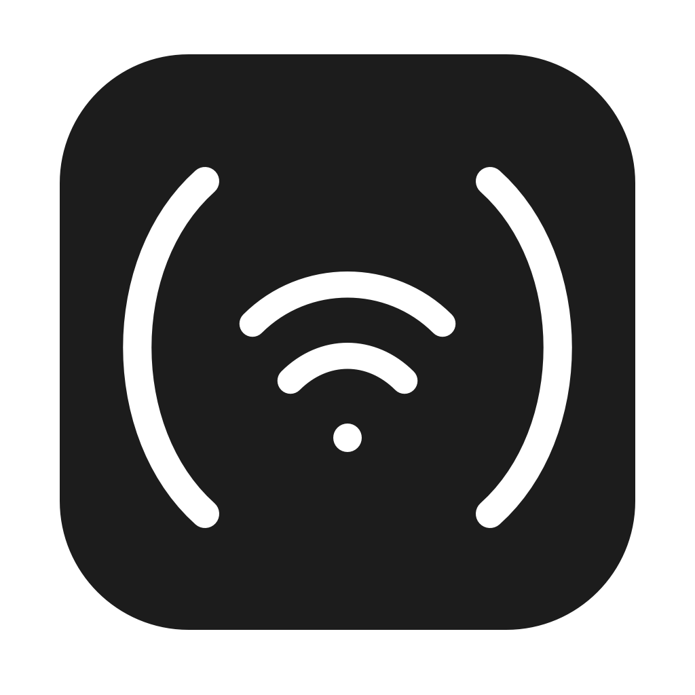
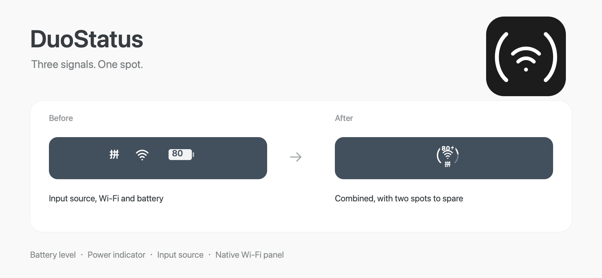
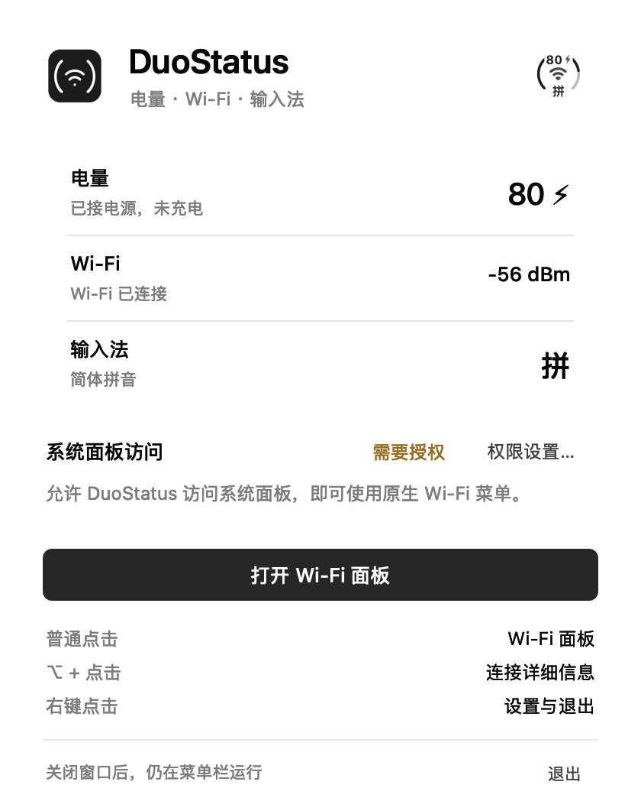

<div align="center">



# DuoStatus

**Battery, Wi-Fi and input source. One menu bar item.**

[](#requirements)
[](#requirements)
[](LICENSE)
[](README-zh.md)

**[Download](https://github.com/zhuxc1221/DuoStatus/releases/latest)** · [Features](#features) · [Set up](#set-up) · [Build](#build-from-source) · [Privacy](#privacy)

<br>



</div>

---

DuoStatus combines battery level, a battery ring, Wi-Fi status and the current input source into a single menu bar icon. Hide the three original system icons and get two spots back. Clicking the combined icon opens the real macOS Wi-Fi panel through Control Center.

## Features

- **One icon:** a battery ring around Wi-Fi, with a numeric charge level overlaid on the ring and no `%` sign.
- **Power indicator:** a lightning bolt appears while connected to external power, including when charging pauses at a charge limit. The number and bolt are centered together; unplugging centers the number alone.
- **Input source:** `拼` for Apple Pinyin and `A` for ABC/English mode, beneath Wi-Fi. Updates from system input-source notifications without monitoring keys.
- **Immediate state updates:** battery and input source use system notifications, independently of the five-second Wi-Fi refresh.
- **Wi-Fi state:** signal strength, disconnected and Wi-Fi-off states, refreshed every five seconds.
- **Native Wi-Fi panel:** personal hotspots, known networks, other networks and Wi-Fi settings remain in the system interface.
- **Option-click:** opens the system's additional connection information.
- **Right-click:** battery status, Wi-Fi settings, the app window and Quit. Click elsewhere to dismiss.
- **System layout:** no overlay windows or manual icon alignment.

The artwork above is an illustration with sample data, not a capture of someone's desktop.

## App window

A compact status list, one main action and a monochrome app icon. Follows the system appearance. The images use sample data.



[Dark appearance](docs/media/window-dark.png)

## Requirements

- macOS 27 or later; tested on macOS 27.2.
- Apple silicon for the downloadable build.
- Control Center must contain its Wi-Fi control.

Other macOS versions and Intel builds have not been validated.

## Set up

1. [Download the latest release](https://github.com/zhuxc1221/DuoStatus/releases/latest), unzip it and move `DuoStatus.app` to Applications. Quit an older copy before opening a replacement.
2. Open DuoStatus. For the native Wi-Fi panel, allow it in **System Settings → Privacy & Security → Device Control and Data Access**. On some macOS versions this permission is called **Accessibility**.
3. In **System Settings → Menu Bar**, turn off the original **Wi-Fi**, **Battery** and **Text Input** items. Leave DuoStatus enabled. Three items are now represented by one combined icon.
4. Keep the existing **Control Center** entry available. DuoStatus uses it to open the native Wi-Fi panel; the original Wi-Fi menu bar icon can stay hidden.

The release is ad-hoc signed and is not notarized by Apple. If macOS blocks it, use the app-specific **Open Anyway** control in **System Settings → Privacy & Security**, or build it from source. The project does not ask you to disable Gatekeeper globally.

Close the app window to leave the menu bar item running. Reopen the app, or choose **显示 DuoStatus 窗口** from its right-click menu, to bring the window back. The current app interface is in Simplified Chinese.

## Privacy

DuoStatus reads battery, Wi-Fi and selected input-source state locally. It has no account, analytics, telemetry or app-initiated network requests. It does not scan nearby networks, read Wi-Fi names or passwords, record the screen or monitor keystrokes.

The system's accessibility permission is broad: it can permit reading and controlling other apps. DuoStatus uses it to locate the existing Control Center entry and invoke the Wi-Fi control's **Show Details** action. It does not press the Wi-Fi toggle to open the panel. The native panel and any network actions you choose there belong to macOS.

Battery, Wi-Fi and input-source status remain readable without this permission; opening the system panel needs it.

## Build from source

Install Xcode Command Line Tools with the macOS 27 SDK, then run:

```sh
git clone https://github.com/zhuxc1221/DuoStatus.git
cd DuoStatus
./build.sh
```

The script builds `dist/DuoStatus.app`, adds the app icon, ad-hoc signs the bundle and runs its self-checks. There are no third-party dependencies.

To run the checks separately:

```sh
./dist/DuoStatus.app/Contents/MacOS/DuoStatus --self-test
```

To regenerate the logo PNG, macOS icon and documentation illustrations:

```sh
./scripts/render-assets.sh
```

Editable SVGs live in `assets/logo/`. Raster assets are drawn with AppKit; the documentation images use sample values only.

## Known limitations

- The native Wi-Fi panel opens beneath **Control Center**, rather than beneath the combined icon. Its position is managed by macOS.
- A Wi-Fi control must be present in Control Center. UI changes in a future macOS release may require an update.
- A lightning bolt means **external power is connected**, which does not always mean the battery is actively charging. The app's menu distinguishes these states.
- Ad-hoc signing does not keep a stable permission identity across rebuilds. If an update loses accessibility access, remove only DuoStatus's old permission entry and add the current app again.
- Notification-to-icon submission is measured in milliseconds, but system notification delivery and display refresh add latency. This is not a hard real-time guarantee.
- Third-party input methods that change internal language mode without publishing a system input-source change may not update the indicator. Only Apple Pinyin/ABC switching has been checked on hardware.
- Hiding Text Input removes its menu entry; keyboard switching still works. The combined icon continues to open Wi-Fi.
- Launch at login is not configured automatically. You can add the app to your login items.

## Validation

On macOS 27.2, the original Wi-Fi and Battery items were both hidden while ordinary click, Option-click and right-click were checked. The right-click menu dismisses when clicking outside. Plugged-in, charging-paused indication was also checked on hardware.

In v0.6, repeated clicking and right-click dismissal were rechecked after removing the native-panel toggle retry. The original Text Input icon was also hidden. Hardware testing confirmed Pinyin/ABC switching, unplugging/reconnecting the adapter, and centered headers in both power states. Self-checks additionally cover header centering at 0/8/80/100, input-source labels and rendering, battery calculations and invalid input, paused-charge indication, signal levels and safe detail-action selection. Actual network switching and third-party input methods have not been validated.

## Credits

[BarTap](https://github.com/ChenFangfc/BarTap) inspired the project's clear bilingual presentation. [baaar](https://github.com/bylaaabs/baaar) helped identify the macOS 27 menu bar host. DuoStatus's logo and documentation illustrations are original assets for this project.

## License

[MIT](LICENSE). Code, documentation and original visual assets are included.
